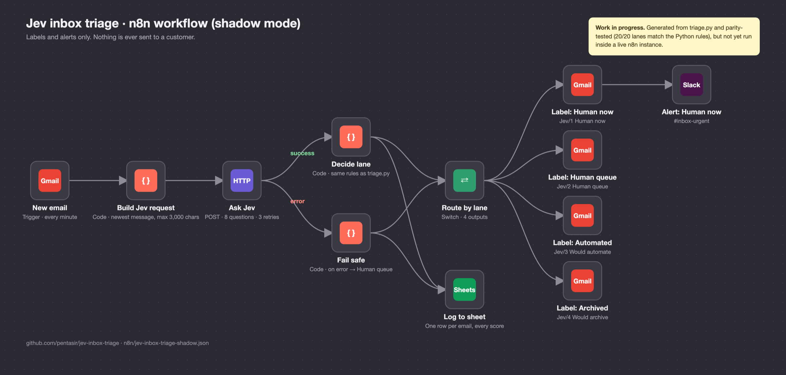

# Jev inbox triage for n8n (shadow mode)

> **Work in progress.** Generated from `triage.py` and parity-tested (20/20 lanes match the Python rules), but not yet imported and run inside a live n8n instance. Expect to re-select options on the Gmail, Slack and Sheets nodes after import.

Labels and alerts only. Nothing is ever sent to a customer. Run it for two weeks on a prospect's real inbox, then hand them the report from the Google Sheet.

## Flow



```
New email (Gmail, every minute)
  → Build Jev request   newest message only, max 3,000 chars, store context
  → Ask Jev             POST /v1/systemone, 8 questions, retries 3x
      ├─ ok    → Decide lane   same rules as triage.py (parity tested 20/20)
      └─ error → Fail safe     sends the email to Human queue, never drops it
  → Log to sheet        one row per email with every score (the shadow report)
  → Route by lane
      ├─ Human now    → Gmail label "Jev/1 Human now"  → Slack alert
      ├─ Human queue  → Gmail label "Jev/2 Human queue"
      ├─ Automated    → Gmail label "Jev/3 Would automate"
      └─ Archived     → Gmail label "Jev/4 Would archive"
```

## Setup (about 15 minutes)

1. n8n → Workflows → Import from file → `jev-inbox-triage-shadow.json`.
2. In the client's Gmail, create the four labels above.
3. **New email** and the four **Label** nodes: add a Gmail OAuth credential. In each Label node, pick its label.
4. **Ask Jev**: create a Header Auth credential. Name `Authorization`, value `Bearer <TypeSafe API key>`.
5. **Alert: Human now**: add a Slack credential and pick the channel (default `#inbox-urgent`).
6. **Log to sheet**: create an empty Google Sheet, pick it and its tab. Columns auto-map on the first row.
7. **Build Jev request**: edit `STORE` to describe the client's shop in one sentence.
8. Test with one email (Execute workflow), check the label, the sheet row and the Slack message. Then activate.

## Notes

- Regenerate after changing questions or thresholds in `triage.py`: `python3 n8n/build_workflow.py`. The template is built from it, so the two never drift.
- `decide.js` holds the lane rules on their own for testing.
- Privacy: customer emails go to TypeSafe. The client's privacy policy should say so, and check TypeSafe's data terms first.
- Going live later: replace a "Would automate" label node with the real action (Shopify tracking reply, returns form) one lane at a time.
- Untested inside n8n itself: node versions and fields were written for n8n 1.x. If a node shows a warning after import, re-select its options; the logic lives in the Code nodes.
